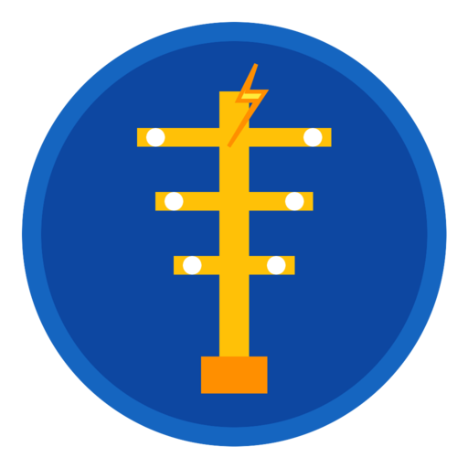

# بازدید ترانس (BazdidTrans)

<p align="center">
  
</p>

<p align="center">
  <b>اپلیکیشن اندروید آفلاین برای ثبت و مدیریت شبکه توزیع برق در بازدیدهای میدانی</b>
</p>

<p align="center">
  
  
  
  
  
</p>

---

## معرفی

**بازدید ترانس** یک اپلیکیشن کاملاً آفلاین است که به کارشناسان و تکنسین‌های شبکه توزیع برق کمک می‌کند در بازدیدهای میدانی:

- پایه‌ها، ترانس‌ها و خطوط را روی نقشه ثبت کنند
- تعداد انشعاب تک‌فاز و سه‌فاز را (کلی و به تفکیک فیدر) وارد کنند
- بار تقریبی ترانس را به صورت خودکار محاسبه کنند
- نقشه دو‌بعدی فشار ضعیف هر ترانس را رسم کنند

همه داده‌ها فقط روی گوشی ذخیره می‌شوند و نیازی به اینترنت ندارد.

---

## قابلیت‌ها

| قابلیت | توضیح |
|--------|--------|
| مدیریت پروژه | هر بازدید یک پروژه جداگانه |
| نقشه آفلاین | ثبت پایه و ترانس روی نقشه با OsmDroid |
| فیدر و انشعاب | ثبت تعداد تک‌فاز و سه‌فاز به تفکیک فیدر |
| محاسبه بار | هر سه‌فاز = ۸ kW ، هر تک‌فاز = ۶ kW |
| درصد بارگیری | در صورت وارد کردن ظرفیت ترانس (kVA) |
| نقشه فشار ضعیف | طراحی دو‌بعدی پایه + خط + خروجی |
| کاملاً آفلاین | Room Database + بدون نیاز به سرور |

---

## فرمول محاسبه بار

```
بار کل (کیلووات) = (تعداد سه‌فاز × ۸) + (تعداد تک‌فاز × ۶)

درصد بارگیری ≈ (بار کل ÷ (ظرفیت kVA × ۰.۸۵)) × ۱۰۰
```

---

## تکنولوژی‌ها

- **زبان:** Kotlin
- **UI:** Material Design Components + View Binding
- **دیتابیس:** Room (SQLite)
- **نقشه:** OsmDroid (پشتیبانی آفلاین)
- **معماری:** MVVM + Coroutines + Flow
- **حداقل اندروید:** API 24 (Android 7.0)

---

## نصب و اجرا

### پیش‌نیاز
- Android Studio Hedgehog (2023.1.1) یا جدیدتر
- JDK 17

### مراحل

1. ریپازیتوری را کلون کنید:
   ```bash
   git clone https://github.com/YOUR_USERNAME/BazdidTrans.git
   cd BazdidTrans
   ```

2. پروژه را در Android Studio باز کنید.

3. صبر کنید تا Gradle Sync کامل شود.

4. یک دستگاه یا شبیه‌ساز انتخاب کرده و Run بزنید.

---

## ساختار پروژه

```
app/src/main/java/com/bazdid/trans/
├── data/
│   ├── entity/          # جداول دیتابیس (Project, Pole, Transformer, Feeder, ...)
│   ├── dao/             # Data Access Objects
│   └── db/              # AppDatabase
├── ui/
│   ├── project/         # لیست و مدیریت پروژه‌ها
│   ├── map/             # صفحه نقشه اصلی
│   ├── transformer/     # جزئیات ترانس و فیدرها
│   └── schematic/       # نقشه دو‌بعدی فشار ضعیف
├── viewmodel/           # ViewModelها
└── util/                # LoadCalculator و ابزارها
```

---


## نقشه آفلاین آماده

فایل نقشه آفلاین در مسیر زیر قرار دارد:

```
app/src/main/assets/maps/mehran_area.mbtiles
```

| مورد | توضیح |
|------|--------|
| حجم | حدود ۱.۵ مگابایت |
| محدوده | بندرخمیر تا نزدیکی بخش مهران بندرلنگه |
| فرمت | MBTiles (سازگار با OsmDroid) |

برای استفاده می‌توانید فایل را به پوشه `osmdroid` گوشی کپی کنید یا مستقیماً از assets بارگذاری نمایید.

---
## مجوز استفاده

این پروژه تحت مجوز **MIT** منتشر شده است. آزادانه استفاده، تغییر و توزیع کنید.

---

## مشارکت

پیشنهادها، گزارش باگ و Pull Requestها با کمال میل پذیرفته می‌شوند.

---

<div align="center">
  ساخته شده برای کارشناسان شبکه توزیع برق ⚡
</div>
